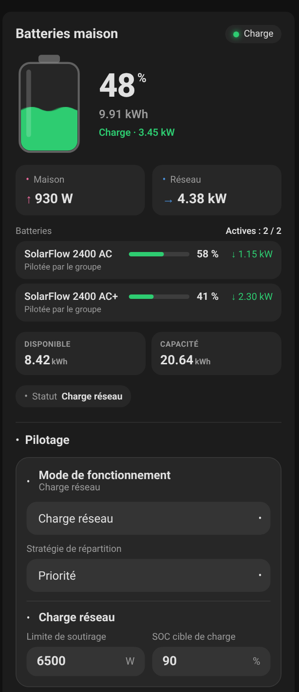
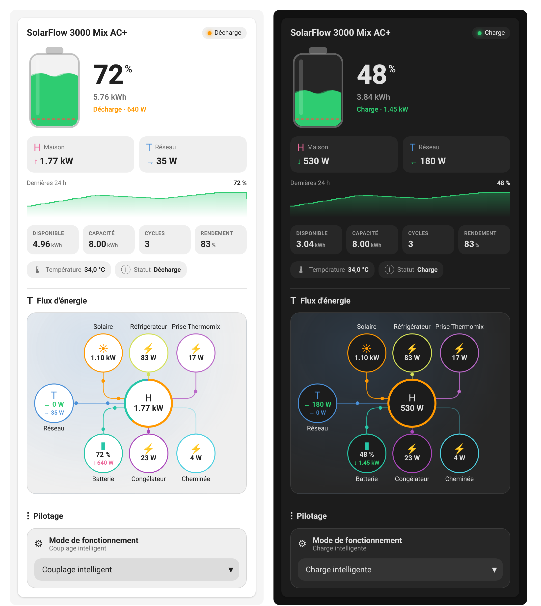

# Zendure SolarFlow Local

[🇫🇷 Français](README.md) · 🇬🇧 English

Home Assistant integration to control **Zendure SolarFlow** batteries **100 % locally**, through the battery's zenSDK HTTP API: no cloud, no MQTT, no YAML. One battery on its own, or a **group of 2 to 4 batteries** working together.

Models with the zenSDK API: SolarFlow 800 / 800 Plus / 800 Pro (2), 1600 AC+, 2400 AC / AC+ / Pro, 3000 Mix AC+, 4000 Mix AC+ / Pro.
Does **not** work with: Hyper 2000, Hub 1200/2000, AIO 2400, Ace 1500 (no local API).

## Requirements

1. A fixed IP for each battery (DHCP reservation on your router), recommended.
2. **Enable the local API** in the Zendure app: device settings → local API / **HEMS**. It is off by default since EN 18031.
3. Quick check in a browser: `http://BATTERY_IP/properties/report` must return JSON.

> ⚠️ **One battery, one controller.** If another integration already controls the battery (for example the Zendure-HA “Zendure Manager”, or a smart-meter mode in the Zendure app), both will fight each other. Set the other controller to `off` for the batteries managed here.

## Installation (HACS)

1. HACS → ⋮ → **Custom repositories** → `https://github.com/JVmaisGpeur/ha-zendure-solarflow-local`, category **Integration**.
2. Install **Zendure SolarFlow Local**, then restart Home Assistant.
3. **Settings → Devices & services → Add integration** → *Zendure SolarFlow Local*. The integration searches the network for batteries (a few seconds), then offers:
   - **Add the batteries found**: tick them, they are all added at once. With two or more batteries, the **Create a group** box (ticked by default) also creates their group;
   - **Add a battery by its IP address**, if it was not found;
   - **Create a battery group**, as soon as two batteries are added.

   The wizard then asks for the **power sensor at the meter** (required: positive when the home draws from the grid, negative when it exports) and, optionally, the **solar production sensor**. The card has nothing left to ask. Everything can be changed later in **Configure**.

Manual installation: copy `custom_components/zendure_local` into `config/custom_components/` and restart.

The interface (entities, options, alerts, card) is in **English** and **French**, following Home Assistant's language.

## Operating modes

| Mode (key) | What the battery does |
|---|---|
| **Off** (`off`) | Neither charges nor discharges (setpoint 0) |
| **Manual power** (`manual`) | Follows the **Power setpoint** |
| **Smart matching** (`smart`) | Stores solar surplus instead of exporting it, and supplies what the home is missing |
| **Smart discharge** (`smart_discharge`) | Only supplies what the home is missing, never charges |
| **Smart charge** (`smart_charge`) | Only stores solar surplus, never discharges |
| **Store solar** (`solar`) | Charges all solar production (solar production sensor required; otherwise like “Smart charge”) |
| **Grid charge** (`grid_charge`) | Charges from the grid without exceeding the **grid import limit**, up to the **charge target SOC** |
| **Controlled by the group** (`group`) | Battery belonging to a group: the group controls it |

Automatic modes need a **grid sensor** (Configure → “Grid sensor”), e.g. Shelly Pro 3EM phase A: **positive when importing, negative when exporting** (otherwise tick “Invert sensor sign”).

The integration handles **no tariffs** (peak / off-peak, Tempo…): your automations change the mode.

### Grid charge: import limit and target SOC

- **Grid import limit** (`import_limit`, W): the battery charges as fast as possible while keeping the meter below this value. Adjustable at any time, from the card or an automation.
- **Charge target SOC** (`charge_target_soc`, %): charging stops at this level and the battery stays idle, without discharging. It only resumes when the SOC drops **3 points** below the target.

> ⚠️ The import limit is **not a strict guarantee**: regulation reacts to the meter reading. When a large appliance starts, import may exceed the limit for 2 to 5 s before correction (about 4 s in simulation). Keep a margin of **at least 10 %** of your subscribed power: `import_limit` = subscribed power − expected large loads − margin.

Example: partial charge to 80 % without exceeding 6 kVA, with a 10 % margin.

```yaml
- action: number.set_value
  target: { entity_id: number.zendure_solarflow_2400_ac_grid_import_limit }
  data: { value: 5400 }
- action: number.set_value
  target: { entity_id: number.zendure_solarflow_2400_ac_charge_target_soc }
  data: { value: 80 }
- action: select.select_option
  target: { entity_id: select.zendure_solarflow_2400_ac_operating_mode }
  data: { option: grid_charge }
```

> `entity_id`s depend on the device name: check them in **Settings → Entities**.

## Battery group

Several batteries on the same meter must not regulate on their own: they would fight each other. A **group** brings 2 to 4 already added batteries under **a single regulator**, which reads the meter once and splits the setpoint. Models may differ (e.g. 2400 AC and 2400 AC+).

**Create a group**: once the batteries are added, Add integration (or “Add entry” on the integration page) → *Zendure SolarFlow Local* → **Create a battery group** → name + batteries. The batteries switch to **“Controlled by the group”**.

- The group is a separate device, controlled exactly like a single battery: same modes, setpoint, import limit, target SOC.
- Each battery keeps its own device, sensors and energy counters.
- Regulation settings (grid sensor, target, deadband, solar sensor…) are set on the group. Those of a member battery are kept but **ignored** while it is a member; the card shows it.
- Changing the mode of a member battery **takes it out of group control** (Repairs alert) without breaking the group. Setting “Controlled by the group” again brings it back.
- Removing a battery from the group (group options) or **deleting the group** gives each battery back its previous mode.

**Dispatch strategy** (`strategy`):

| Key | Behaviour |
|---|---|
| `simultaneous` | Setpoint split in proportion to each battery's maximum power |
| `soc_balance` (default) | The fullest discharges more, the emptiest charges more: SOCs converge |
| `priority` | Order set in the options: the first battery works alone up to its limit (power or SOC), then the next one takes over |

**Dispatcher safety**
- Never one battery charging while another discharges.
- Each battery stays within its limits (power, min / max SOC, target SOC); what it cannot take is moved to the others.
- An unreachable, faulty or released battery leaves the dispatch: the group keeps running with the others (**Degraded** state, Repairs alert) and takes it back when it returns.



## Power limits and circuits

- **Maximum charge / discharge power**: options of each battery.
- **Circuit limit** (W): if the battery is plugged on a limited circuit (like Zendure-HA “fuse groups”, e.g. 1200 W), it will never exceed it.
- **Shared circuits** (group options): several batteries on the same circuit with a common limit.
- Limits reported by the battery itself (maximum power, thermal derating) are respected too.

The **Max charge power** and **Max discharge power** sensors show the limit actually applied.

## Capacity and energy

**Usable capacity** is computed from the type of each detected pack:

| Pack | Capacity |
|---|---|
| AB3000 | 2.88 kWh |
| AB2000S | 1.92 kWh |
| AB3000L | 2.88 kWh |
| I2400 (built into the 2400 AC+) | 2.40 kWh |
| Built-in pack of the 3000 / 4000 Mix AC+ (packType 70) | 8.0 kWh |

An unknown pack raises an alert: enter the capacity in the battery options. **Available energy** = capacity × (SOC − min SOC); **Missing energy** = capacity × (max SOC − SOC).

## Lovelace card included

The integration installs and loads its own card: **nothing to add to resources or HACS**.



Dashboard → **Edit** → **Add card** → **Zendure SolarFlow**, or in YAML:

```yaml
type: custom:zendure-solarflow-card
device_id: ...                     # optional: battery or group (otherwise the first one found)
name: My battery                   # optional
solar_entity: sensor.solar_power   # optional: overrides the solar sensor set in the integration
consumers:                         # optional, up to 5 devices
  - sensor.fridge_power
show_history: true
show_flow: true
```

It shows the animated battery (or the global SOC of a group), the 24 h chart, capacity, energy flows, regulation state and controls: mode, strategy (group), Grid charge (import limit, target SOC), min / max charge levels, manual power. For a group, one row per battery (SOC, power, state).

## Regulation

- Recomputed on **every meter reading** (about 1 s with a Shelly), battery polled every 2 s while regulating.
- Protection against overshoot and oscillation; **fine trim** of small persistent offsets.
- **Auto-tuning** (on by default): learns the meter rate, its noise and the batteries' response time; **Measure battery response** and **Reset learning** buttons.

## Sign conventions

| Value | + | − |
|---|---|---|
| `battery_power` (Battery power sensor) | charging | discharging |
| `power_setpoint` (Power setpoint) | discharging to the home | charging |
| Grid sensor | import | export |

These conventions will not change (harmonising them would break existing automations).

## Interface for other integrations

A single battery and a group expose the same control entities (**interface version 1**). Find them through the Home Assistant registry (device + `translation_key`), never by `entity_id`.

| `translation_key` | Type | Unit / values | Battery | Group |
|---|---|---|---|---|
| `operating_mode` | select | `off`, `manual`, `smart`, `smart_discharge`, `smart_charge`, `solar`, `grid_charge` (+ `group` on a member battery) | ✓ | ✓ |
| `power_setpoint` | number | W, + discharge, − charge | ✓ | ✓ (total, dispatched) |
| `import_limit` | number | W | ✓ | ✓ |
| `charge_target_soc` | number | % | ✓ | ✓ |
| `electric_level` | sensor | % | ✓ | ✓ (capacity-weighted) |
| `usable_capacity` | sensor | kWh | ✓ | ✓ |
| `available_energy` / `missing_energy` | sensor | kWh | ✓ | ✓ |
| `battery_power` | sensor | W, + charge, − discharge | ✓ | ✓ |
| `max_charge_power` / `max_discharge_power` | sensor | W | ✓ | ✓ |
| `regulation_state` | sensor (enum) | `off`, `manual`, `regulating`, `grid_charging`, `target_reached`, `import_limited`, `soc_max_reached`, `soc_min_reached`, `sensor_unavailable`, `error` (+ `group` on a member, `degraded` on a group) | ✓ | ✓ |
| `strategy` | select | `simultaneous`, `soc_balance`, `priority` | — | ✓ |
| `active_batteries` | sensor | count | — | ✓ |

Rules:
- An unknown enum value must be treated as “not handled”.
- Renaming or removing anything in this table, or changing a unit or sign, requires a major version (2.0.0), announced one version ahead in the CHANGELOG.
- Diagnostic sensors, options and attributes are not part of the interface.
- **Key language**: this interface uses English keys, while the ha-tarifs-electricite integration keeps French keys (already published). This is deliberate and must not be “fixed” without a major version.

Usage example: an external controller (for instance a future “energy conductor” taking tariffs and solar forecast into account) schedules an off-peak charge with `import_limit`, `charge_target_soc` and `operating_mode` = `grid_charge`. The integration simply applies the latest command received, whoever sent it.

## Technical details

- Read: `GET http://IP/properties/report`; write: `POST http://IP/properties/write`.
- Discharge: `acMode: 2` + `outputLimit`; charge: `acMode: 1` + `inputLimit`; frequent commands written to RAM (`smartMode: 1`).
- `socSet` / `minSoc` in tenths of %; temperatures in tenths of kelvin.
- Automatic discovery via mDNS `_zendure._tcp`.

## Tests

`tests/` holds tests for the dispatcher, translations, the interface contract and regulation scenarios (single battery, grid charge, 30-minute group run, strategies, unplugged battery, members), run with the real code in simulated time:

```bash
python3 tests/run_all.py
```

## License

MIT © JVmaisGpeur
