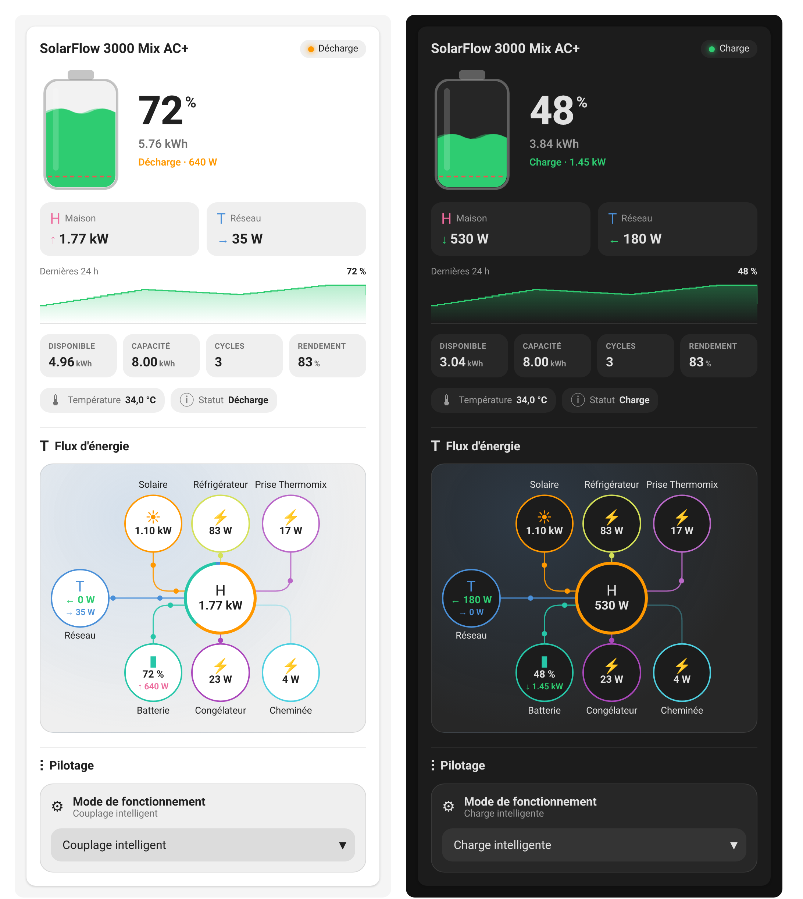

# Zendure SolarFlow Local

Intégration Home Assistant pour piloter une batterie **Zendure SolarFlow** (testée pour la **SolarFlow 3000 Mix AC+**) **100 % en local**, via l'API HTTP zenSDK de la batterie : pas de cloud, pas de MQTT, pas de YAML.

Modèles compatibles avec l'API zenSDK : SolarFlow 800 / 800 Plus / 800 Pro (2), 1600 AC+, 2400 AC / AC+ / Pro, 3000 Mix AC+, 4000 Mix AC+ / Pro.
Ne fonctionne **pas** avec : Hyper 2000, Hub 1200/2000, AIO 2400, Ace 1500 (pas d'API locale).

## Prérequis

1. Une IP fixe pour la batterie (réservation DHCP sur la box), conseillé.
2. **Activer l'API locale** dans l'app Zendure : réglages de l'appareil → API locale / **HEMS**. Elle est désactivée par défaut depuis la norme EN 18031.
3. Test rapide depuis un navigateur : `http://IP_DE_LA_BATTERIE/properties/report` doit renvoyer du JSON.

## Installation (HACS)

1. HACS → ⋮ → **Dépôts personnalisés** → `https://github.com/JVmaisGpeur/ha-zendure-solarflow-local`, catégorie **Intégration**.
2. Installer **Zendure SolarFlow Local**, puis redémarrer Home Assistant.
3. **Paramètres → Appareils et services** : la batterie est en général détectée toute seule. Sinon, **Ajouter une intégration** → *Zendure SolarFlow Local* → saisir l'IP.

Installation manuelle : copier `custom_components/zendure_local` dans `config/custom_components/` puis redémarrer.

## Carte Lovelace incluse

L'intégration installe et charge sa propre carte : **rien à ajouter dans les ressources ni dans HACS**.



Tableau de bord → **Modifier** → **Ajouter une carte** → cherche **Zendure SolarFlow**. Ou, en YAML :

```yaml
type: custom:zendure-solarflow-card
```

La carte trouve toute seule les entités de la batterie, quels que soient leurs noms ou la langue. Tout se règle aussi dans l'éditeur visuel :

```yaml
type: custom:zendure-solarflow-card
name: Ma batterie                  # facultatif
capacity: 8                        # kWh, facultatif (déduit du modèle sinon)
solar_entity: sensor.production_solaire_puissance   # facultatif
consumers:                         # facultatif, 5 appareils max
  - sensor.refrigerateur_puissance
  - sensor.congelateur_puissance
show_history: true
show_flow: true
```

Ce qu'elle affiche :
- **Batterie** : niveau dans une batterie « liquide » animée, avec la limite du SOC minimum en pointillés rouges, l'énergie stockée et l'état (veille, charge, décharge). Les puissances Maison et Réseau sont dans le schéma des flux ; si le schéma est désactivé (`show_flow: false`), elles s'affichent en tuiles sous la batterie.
- **Courbe des dernières 24 h** du niveau de charge.
- **Disponible / Capacité / Cycles / Rendement**. Les cycles et le rendement sont calculés à partir des compteurs d'énergie de l'intégration, depuis son installation.
- **Flux d'énergie** : Réseau, Solaire, Batterie et jusqu'à 5 appareils autour de la Maison. Des points animés montrent le sens de circulation de l'énergie, et l'anneau de la Maison indique la part de chaque source.
- **Pilotage** : liste déroulante du mode de fonctionnement et cases pour les niveaux de charge **minimum** et **maximum**. En **Puissance manuelle**, deux cases **Charge manuelle** / **Décharge manuelle** et une saisie de la puissance en W (envoyée à la validation), plus un bouton pour mettre au repos.

Un appui sur un élément ouvre son historique. La carte suit le thème clair ou sombre et la langue de Home Assistant (français ou anglais).

> Après une mise à jour de l'intégration, si la carte ne change pas, vide le cache du navigateur ou de l'app (Paramètres de l'app → Débogage → Réinitialiser le cache).

## Entités

| Type | Entités |
|---|---|
| Pilotage | **Consigne de puissance** (W) : `+` = décharge vers la maison, `−` = charge sur le réseau, `0` = repos |
| Réglages | Limite de charge AC, Limite de sortie, Mode AC (charge/décharge), SOC maximum (70–100 %), SOC minimum (0–50 %), Mode hors-réseau |
| Mesures | Niveau de charge, Puissance batterie (+ en charge), Puissance de charge / décharge, vers la maison, prise au réseau, solaire, prise de secours, Autonomie restante, État, Température |
| Énergie | Énergie chargée, déchargée, fournie à la maison, prise au réseau (kWh, compatibles avec le tableau de bord Énergie) |
| Packs | Niveau, température, tension, courant, cellules min/max par pack |
| Diagnostic | Défaut, Chauffage batterie, Réseau connecté, By-pass, Signal Wi-Fi |

## Réglage automatique de la régulation

Chaque installation est différente : vitesse de la batterie, rythme du compteur (Shelly environ 1 s, P1 ou Linky 2 à 10 s), consommation plus ou moins fluctuante. Avec l'interrupteur **Réglage automatique de la régulation**, activé par défaut, l'intégration **observe ton installation sans rien forcer** et adapte seule ses réglages.

| Ce qu'elle apprend | Ce qu'elle en déduit |
|---|---|
| Rythme du compteur | Délai entre deux calculs |
| Bruit du compteur (fluctuation quand rien ne change) | Zone morte : on ne court plus après le bruit |
| Délai de réaction et temps de réponse de la batterie | Temps d'attente anti-oscillation |
| Dépassements ou corrections trop timides | Gain, entre 0,5 et 1 |

- Les valeurs apprises sont visibles dans les **capteurs de diagnostic** de l'appareil et conservées après un redémarrage.
- Tant qu'il n'y a pas assez de mesures, les valeurs par défaut s'appliquent.
- **Mesurer la réponse de la batterie** : ce bouton fait un petit échelon de 300 W pendant environ 12 s pour calibrer tout de suite, au lieu d'attendre quelques heures d'observation.
- **Réinitialiser l'apprentissage** : à utiliser après un changement de compteur ou de batterie.
- Si tu coupes le réglage automatique, la régulation reprend les valeurs de **Configurer**.

En simulation sur 4 profils d'installation, la précision au compteur reste la même qu'avec les réglages fixes, mais la batterie reçoit **47 à 85 % de commandes en moins**.

## Options

Bouton **Configurer** sur l'intégration :
- **Niveau de charge minimum / maximum** (%) : ils sont enregistrés directement dans la batterie. On peut aussi les régler avec les entités « SOC minimum » et « SOC maximum » ou depuis la carte.
- **Intervalle de lecture** : 10 s par défaut, quand aucune régulation ne tourne.
- **Lecture de la batterie pendant la régulation** : 2 s par défaut.
- **Puissance max** : 3000 W par défaut.
- **Écrire en RAM** (activé par défaut) : les commandes de puissance ne s'écrivent pas dans la mémoire flash.
- **Capteur réseau**, **capteur de production solaire**, **inverser le signe**, **cible au compteur**, **zone morte**, **délai minimum entre deux calculs** (1 s par défaut), **soutirage max en charge réseau**.

## Modes de fonctionnement

Le sélecteur **Mode de fonctionnement** pilote la batterie :

| Mode | Ce que fait la batterie |
|---|---|
| **Arrêt** | Ne charge ni ne décharge (consigne 0) |
| **Puissance manuelle** | Suit la **Consigne de puissance** (+ décharge, − charge) |
| **Couplage intelligent** | Stocke le surplus solaire au lieu de l'injecter, et fournit à la maison ce qui manque quand la production ne suffit pas |
| **Décharge intelligente** | Fournit seulement ce qui manque à la maison. Ne se charge jamais |
| **Charge intelligente** | Stocke seulement le surplus solaire. Ne se décharge jamais : l'énergie est gardée pour plus tard |
| **Stocker le solaire** | Charge toute la production solaire, même si la maison consomme (il faut un **capteur de production solaire**). Sans ce capteur, se comporte comme « Charge intelligente » |
| **Charge réseau** | Charge sur le réseau au maximum possible sans dépasser le **soutirage max au compteur** (6000 W par défaut) |

Le mode est mémorisé au redémarrage. Si tu changes la consigne à la main, le mode repasse en **Puissance manuelle**.
L'attribut `statut` du sélecteur indique ce que fait la batterie (stable, charge, décharge, batterie pleine…).

### Capteurs (obligatoires pour les modes automatiques)

1. **Configurer** sur l'intégration → **Capteur réseau** : choisis n'importe quel capteur de puissance, par ex. la phase A d'un Shelly Pro 3EM.
   Il doit être **positif quand tu soutires** et **négatif quand tu injectes** (c'est le cas du Shelly). Sinon coche **Inverser le signe**.
2. **Capteur de production solaire** (facultatif) : il sert au mode « Stocker le solaire ». La carte l'affiche aussi automatiquement dans les flux.

### Une régulation la plus réactive possible

- Elle recalcule **à chaque nouvelle mesure du compteur** (environ toutes les secondes avec un Shelly), au lieu d'attendre un minuteur.
- Pendant la régulation, la batterie est relue toutes les 2 s, et juste après chaque commande.
- La batterie met quelques secondes à atteindre une nouvelle consigne. Pendant ce temps, la régulation ne la pousse pas plus loin dans le même sens, ce qui évite les dépassements et les oscillations. Une correction en sens inverse, par exemple si la consommation chute, part immédiatement.
- En simulation, après un appel de charge de 1500 W, l'équilibre au compteur revient en 3 à 4 s.
- **Affinage fin** : la zone morte évite de courir après les fluctuations, mais un petit écart **qui dure** (par exemple 16 W soutirés en permanence) n'est pas du bruit. La régulation suit la moyenne de l'écart et, après 12 s sans commande, le corrige par petits pas de 10 W. En simulation, l'écart moyen au compteur tombe à environ 2 W.

Réglages : **cible au compteur** (0 W), **zone morte** (25 W), **délai minimum entre deux calculs** (1 s).

Sécurités :
- Pas de décharge sous le SOC minimum ni de charge au-dessus du SOC maximum.
- Si le capteur devient indisponible, la batterie passe au repos.

⚠️ Désactive toute régulation dans l'app Zendure (mode compteur intelligent) : les deux se contrediraient.

## Exemple d'automatisation

L'intégration ne gère **aucun tarif** (heures pleines/creuses, Tempo…) : c'est le rôle de tes automatisations, qui changent simplement le mode. Par exemple :

```yaml
automation:
  - alias: Batterie - passer en charge réseau
    triggers:
      - trigger: state
        entity_id: input_boolean.charger_batterie_sur_reseau
        to: "on"
    actions:
      - action: select.select_option
        target:
          entity_id: select.zendure_solarflow_mode_de_fonctionnement
        data:
          option: grid_charge
```

Valeurs possibles pour `option` : `off`, `manual`, `smart`, `smart_discharge`, `smart_charge`, `solar`, `grid_charge`.

> Les `entity_id` dépendent du nom donné à l'appareil : vérifie-les dans **Paramètres → Entités**.

## Fonctionnement technique

- Lecture : `GET http://IP/properties/report`
- Écriture : `POST http://IP/properties/write` avec `{"sn": "...", "properties": {...}}`
- Décharge : `acMode: 2` + `outputLimit` ; charge : `acMode: 1` + `inputLimit`
- `socSet` / `minSoc` sont stockés par l'appareil en dixièmes de % (1000 = 100 %)
- Découverte automatique via mDNS `_zendure._tcp`

## Feuille de route

- **Plusieurs batteries** (2 ou 3) qui travaillent ensemble : charge et décharge en simultané, ou par ordre de priorité, dans l'intégration comme dans la carte. Pour l'instant, l'intégration pilote une seule batterie.

## Licence

MIT © JVmaisGpeur
