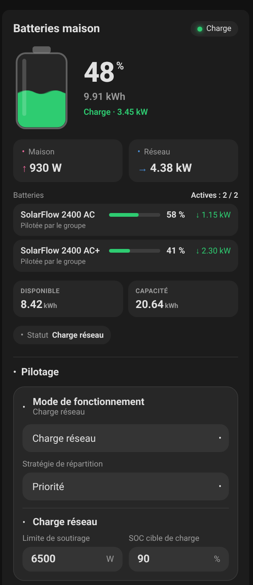

# Zendure SolarFlow Local

🇫🇷 Français · [🇬🇧 English](README.en.md)

Intégration Home Assistant pour piloter des batteries **Zendure SolarFlow** **100 % en local**, via l'API HTTP zenSDK de la batterie : pas de cloud, pas de MQTT, pas de YAML. Une batterie seule ou un **groupe de 2 à 4 batteries** qui travaillent ensemble.

Modèles compatibles avec l'API zenSDK : SolarFlow 800 / 800 Plus / 800 Pro (2), 1600 AC+, 2400 AC / AC+ / Pro, 3000 Mix AC+, 4000 Mix AC+ / Pro.
Ne fonctionne **pas** avec : Hyper 2000, Hub 1200/2000, AIO 2400, Ace 1500 (pas d'API locale).

## Prérequis

1. Une IP fixe pour chaque batterie (réservation DHCP sur la box), conseillé.
2. **Activer l'API locale** dans l'app Zendure : réglages de l'appareil → API locale / **HEMS**. Elle est désactivée par défaut depuis la norme EN 18031.
3. Test rapide depuis un navigateur : `http://IP_DE_LA_BATTERIE/properties/report` doit renvoyer du JSON.

> ⚠️ **Une batterie, un seul pilote.** Si une autre intégration pilote déjà la batterie (par exemple le « Zendure Manager » de Zendure-HA, ou un mode compteur intelligent dans l'app Zendure), les deux se contredisent. Mets l'autre pilote sur `off` pour les batteries gérées ici.

## Installation (HACS)

1. HACS → ⋮ → **Dépôts personnalisés** → `https://github.com/JVmaisGpeur/ha-zendure-solarflow-local`, catégorie **Intégration**.
2. Installer **Zendure SolarFlow Local**, puis redémarrer Home Assistant.
3. **Paramètres → Appareils et services** : la batterie est en général détectée toute seule. Sinon, **Ajouter une intégration** → *Zendure SolarFlow Local* → **Ajouter une batterie** → saisir l'IP.

Installation manuelle : copier `custom_components/zendure_local` dans `config/custom_components/` puis redémarrer.

L'interface (entités, options, alertes, carte) est en **français** et en **anglais**, selon la langue de Home Assistant.

## Modes de fonctionnement

| Mode (clé) | Ce que fait la batterie |
|---|---|
| **Arrêt** (`off`) | Ne charge ni ne décharge (consigne 0) |
| **Puissance manuelle** (`manual`) | Suit la **Consigne de puissance** |
| **Couplage intelligent** (`smart`) | Stocke le surplus solaire au lieu de l'injecter, et fournit à la maison ce qui manque |
| **Décharge intelligente** (`smart_discharge`) | Fournit seulement ce qui manque à la maison, ne se charge jamais |
| **Charge intelligente** (`smart_charge`) | Stocke seulement le surplus solaire, ne se décharge jamais |
| **Stocker le solaire** (`solar`) | Charge toute la production solaire (capteur de production solaire requis ; sinon comme « Charge intelligente ») |
| **Charge réseau** (`grid_charge`) | Charge sur le réseau sans dépasser la **limite de soutirage**, jusqu'au **SOC cible de charge** |
| **Pilotée par le groupe** (`group`) | Batterie membre d'un groupe : c'est le groupe qui la commande |

Les modes automatiques ont besoin d'un **capteur réseau** (Configurer → « Capteur réseau »), par exemple la phase A d'un Shelly Pro 3EM : **positif quand on soutire, négatif quand on injecte** (sinon cocher « Inverser le signe »).

L'intégration ne gère **aucun tarif** (heures pleines / creuses, Tempo…) : ce sont tes automatisations qui changent le mode.

### Charge réseau : limite de soutirage et SOC cible

- **Limite de soutirage** (`import_limit`, W) : la batterie charge aussi vite que possible sans que le compteur dépasse cette valeur. Réglable à chaud, depuis la carte ou une automatisation.
- **SOC cible de charge** (`charge_target_soc`, %) : la charge s'arrête à ce niveau et la batterie reste au repos, sans décharger. Elle ne reprend que si le SOC redescend de **3 points** sous la cible.

> ⚠️ La limite de soutirage n'est **pas une garantie stricte** : la régulation réagit à la mesure du compteur. Quand un gros appareil démarre, le soutirage peut dépasser la limite pendant 2 à 5 s avant correction (environ 4 s en simulation). Garde une marge d'**au moins 10 %** de ta puissance souscrite : `import_limit` = puissance souscrite − gros consommateurs prévus − marge.

Exemple : charge partielle à 80 % sans dépasser 6 kVA avec 10 % de marge.

```yaml
- action: number.set_value
  target: { entity_id: number.zendure_solarflow_2400_ac_limite_de_soutirage }
  data: { value: 5400 }
- action: number.set_value
  target: { entity_id: number.zendure_solarflow_2400_ac_soc_cible_de_charge }
  data: { value: 80 }
- action: select.select_option
  target: { entity_id: select.zendure_solarflow_2400_ac_mode_de_fonctionnement }
  data: { option: grid_charge }
```

> Les `entity_id` dépendent du nom de l'appareil : vérifie-les dans **Paramètres → Entités**.

## Groupe de batteries

Plusieurs batteries sur le même compteur ne doivent pas réguler chacune de leur côté : elles se contrediraient. Un **groupe** réunit 2 à 4 batteries déjà ajoutées sous **un seul régulateur**, qui lit le compteur une fois et répartit la consigne. Les modèles peuvent être différents (par exemple 2400 AC et 2400 AC+).

**Créer un groupe** : Ajouter une intégration → *Zendure SolarFlow Local* → **Créer un groupe de batteries** → nom + batteries. Les batteries passent en mode **« Pilotée par le groupe »**.

- Le groupe est un appareil à part, piloté exactement comme une batterie seule : mêmes modes, consigne, limite de soutirage, SOC cible.
- Chaque batterie garde son appareil, ses capteurs et ses compteurs d'énergie.
- Les réglages de régulation (capteur réseau, cible, zone morte, capteur solaire…) se font sur le groupe. Ceux d'une batterie membre sont conservés mais **ignorés** tant qu'elle est membre ; la carte l'indique.
- Changer le mode d'une batterie membre la **sort du pilotage** (alerte dans Réparations), sans défaire le groupe. Remettre « Pilotée par le groupe » la réintègre.
- Retirer une batterie du groupe (options du groupe) ou **supprimer le groupe** rend à chaque batterie son mode d'avant.

**Stratégie de répartition** (`strategy`) :

| Clé | Comportement |
|---|---|
| `simultaneous` (Simultanée) | Consigne répartie au prorata de la puissance max de chaque batterie |
| `soc_balance` (Équilibrage des SOC, par défaut) | La plus pleine décharge davantage, la plus vide charge davantage : les SOC convergent |
| `priority` (Priorité) | Ordre fixé dans les options : la première travaille seule jusqu'à sa limite (puissance ou SOC), puis la suivante prend le relais |

**Sécurité du répartiteur**
- Jamais une batterie en charge pendant qu'une autre décharge.
- Chaque batterie reste dans ses limites (puissance, SOC min / max, SOC cible) ; ce qu'elle ne peut pas prendre est reporté sur les autres.
- Une batterie injoignable, en défaut ou sortie du pilotage quitte la répartition : le groupe continue avec les autres (état **Dégradé**, alerte dans Réparations) et la reprend à son retour.



## Limites de puissance et circuits

- **Puissance de charge / décharge maximale** : options de chaque batterie.
- **Limite du circuit** (W) : si la batterie est branchée sur un circuit limité (équivalent des « groupes de fusible » de Zendure-HA, par exemple 1200 W), elle ne le dépassera jamais.
- **Circuits partagés** (options du groupe) : plusieurs batteries sur le même circuit avec une limite commune.
- Les limites annoncées par la batterie elle-même (puissance max, réduction en cas de chaleur) sont aussi respectées.

Les capteurs **Puissance de charge max** et **Puissance de décharge max** affichent la limite réellement appliquée.

## Capacité et énergie

La **capacité utile** est calculée d'après le type de chaque pack détecté :

| Pack | Capacité |
|---|---|
| AB3000 | 2,88 kWh |
| AB2000S | 1,92 kWh |
| AB3000L | 2,88 kWh |
| I2400 (intégré à la 2400 AC+) | 2,40 kWh |

Un pack inconnu déclenche une alerte : saisis alors la capacité dans les options de la batterie. **Énergie disponible** = capacité × (SOC − SOC min) ; **Énergie manquante** = capacité × (SOC max − SOC).

## Carte Lovelace incluse

L'intégration installe et charge sa propre carte : **rien à ajouter dans les ressources ni dans HACS**.


Tableau de bord → **Modifier** → **Ajouter une carte** → **Zendure SolarFlow**, ou en YAML :

```yaml
type: custom:zendure-solarflow-card
device_id: ...                     # facultatif : batterie ou groupe (sinon le premier trouvé)
name: Ma batterie                  # facultatif
solar_entity: sensor.production_solaire_puissance   # facultatif
consumers:                         # facultatif, 5 appareils max
  - sensor.refrigerateur_puissance
show_history: true
show_flow: true
```

Elle affiche la batterie animée (ou le SOC global d'un groupe), la courbe 24 h, la capacité, les flux d'énergie, l'état de la régulation et le pilotage : mode, stratégie (groupe), Charge réseau (limite de soutirage, SOC cible), niveaux de charge min / max, puissance manuelle. Pour un groupe, une ligne par batterie (SOC, puissance, état).

## Régulation

- Recalcul à **chaque mesure du compteur** (environ 1 s avec un Shelly), batterie relue toutes les 2 s pendant la régulation.
- Protection contre les dépassements et oscillations ; **affinage fin** des petits écarts qui durent.
- **Réglage automatique** (activé par défaut) : apprend le rythme du compteur, son bruit et le temps de réponse des batteries ; boutons **Mesurer la réponse de la batterie** et **Réinitialiser l'apprentissage**.

## Conventions de signe

| Grandeur | + | − |
|---|---|---|
| `battery_power` (capteur Puissance batterie) | charge | décharge |
| `power_setpoint` (Consigne de puissance) | décharge vers la maison | charge |
| Capteur réseau | soutirage | injection |

Ces conventions ne changeront pas (les harmoniser casserait les automatisations existantes).

## Interface pour les autres intégrations

Une batterie seule et un groupe exposent les mêmes entités de pilotage (**version d'interface 1**). Retrouve-les par le registre de Home Assistant (appareil + `translation_key`), jamais par leur `entity_id`.

| `translation_key` | Type | Unité / valeurs | Batterie | Groupe |
|---|---|---|---|---|
| `operating_mode` | select | `off`, `manual`, `smart`, `smart_discharge`, `smart_charge`, `solar`, `grid_charge` (+ `group` sur une batterie membre) | ✓ | ✓ |
| `power_setpoint` | number | W, + décharge, − charge | ✓ | ✓ (total réparti) |
| `import_limit` | number | W | ✓ | ✓ |
| `charge_target_soc` | number | % | ✓ | ✓ |
| `electric_level` | sensor | % | ✓ | ✓ (pondéré par la capacité) |
| `usable_capacity` | sensor | kWh | ✓ | ✓ |
| `available_energy` / `missing_energy` | sensor | kWh | ✓ | ✓ |
| `battery_power` | sensor | W, + charge, − décharge | ✓ | ✓ |
| `max_charge_power` / `max_discharge_power` | sensor | W | ✓ | ✓ |
| `regulation_state` | sensor (enum) | `off`, `manual`, `regulating`, `grid_charging`, `target_reached`, `import_limited`, `soc_max_reached`, `soc_min_reached`, `sensor_unavailable`, `error` (+ `group` sur un membre, `degraded` sur un groupe) | ✓ | ✓ |
| `strategy` | select | `simultaneous`, `soc_balance`, `priority` | — | ✓ |
| `active_batteries` | sensor | nombre | — | ✓ |

Règles :
- Une valeur d'enum inconnue doit être traitée comme « non gérée ».
- Renommer ou supprimer un élément de ce tableau, changer une unité ou un signe impose une version majeure (2.0.0), annoncée une version à l'avance dans le CHANGELOG.
- Les capteurs de diagnostic, les options et les attributs ne font pas partie de l'interface.
- **Langue des clés** : les clés de cette interface sont en anglais, celles de l'intégration ha-tarifs-electricite restent en français (déjà publiées). C'est un choix volontaire, qui ne doit pas être « corrigé » sans version majeure.

Exemple d'usage : un pilote externe (par exemple un futur « Chef d'orchestre énergie » qui tient compte des tarifs et de la prévision solaire) programme une charge en heures creuses avec `import_limit`, `charge_target_soc` et `operating_mode` = `grid_charge`. L'intégration applique simplement la dernière commande reçue, d'où qu'elle vienne.

## Fonctionnement technique

- Lecture : `GET http://IP/properties/report` ; écriture : `POST http://IP/properties/write`.
- Décharge : `acMode: 2` + `outputLimit` ; charge : `acMode: 1` + `inputLimit` ; commandes fréquentes écrites en RAM (`smartMode: 1`).
- `socSet` / `minSoc` en dixièmes de % ; températures en dixièmes de kelvin.
- Découverte automatique via mDNS `_zendure._tcp`.

## Tests

`tests/` contient les tests du répartiteur, des traductions, du contrat d'interface et des scénarios de régulation (batterie seule, charge réseau, groupe sur 30 minutes, stratégies, batterie débranchée, membres), joués avec le vrai code en temps simulé :

```bash
python3 tests/run_all.py
```

## Licence

MIT © JVmaisGpeur
